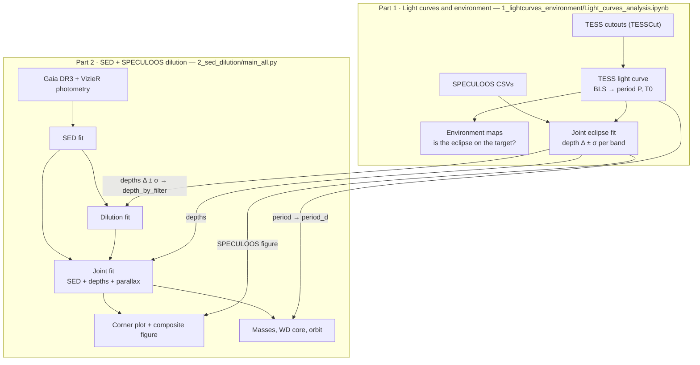
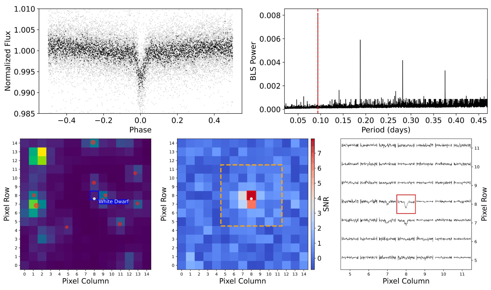
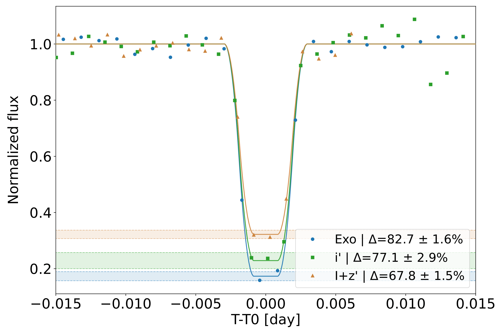

# WD+MS fitting pipeline — from TESS light curves to SED + SPECULOOS dilution

This repository studies **eclipsing white dwarf + M dwarf (WD+MS) binaries**, from the discovery light curve to the stellar parameters. It works in two parts, run one after the other:

1. **Light curves and environment** (a notebook). Find the eclipse in TESS data, measure the period, check that the eclipse comes from the target, and measure the eclipse depth in each SPECULOOS band.
2. **SED + SPECULOOS dilution analysis** (a Python pipeline). Combine the broadband spectral energy distribution (SED) with those eclipse depths to measure the temperature and radius of both stars, the distance and extinction, then the masses, the white-dwarf core composition and the orbit.

> **Status.** The code and documentation are ready to share. The small model tables are included; the notebook `0_setup/setup_pipeline.ipynb` installs the Python packages and downloads the model grids. No full fit was rerun while preparing the repository.

## Overview



## Repository layout

```
wdms-fitting-pipeline/
├── 0_setup/
│   └── setup_pipeline.ipynb      run once: Python packages + model grids
├── 1_lightcurves_environment/
│   └── Light_curves_analysis.ipynb   Part 1: TESS + SPECULOOS light curves, environment maps
├── 2_sed_dilution/
│   ├── main_all.py               Part 2 entry point: settings, targets, run
│   ├── sed_fit.py … mass.py      the pipeline modules (table below)
│   ├── filters/                  SPECULOOS filter profiles
│   └── tables/                   Bédard, BHAC15, La Plata tables (included)
├── docs/                         detailed documentation and figures
└── requirements.txt              Python packages
```

Both parts read and write in one **workspace** folder outside the repository, `<WORKSPACE>` = `<DOWNLOADS>/WDMS_fitting_pipeline/`, one sub-folder per target:

```
<WORKSPACE>/
├── models/koester2/              Koester DA spectra (to download)
├── model_cache/                  PHOENIX, BT-Settl, filter curves (downloaded automatically)
├── TIC450781262/
│   ├── tess_cutouts/  light_curve/  environment_maps/     ← Part 1
│   ├── speculoos_csv/                                      ← you put the SPECULOOS CSVs here
│   ├── speculoos_light_curve/                              ← Part 1 (figure reused by Part 2)
│   └── SED-dilution analysis/                              ← Part 2
└── SED-dilution summaries/                                 ← Part 2, whole sample
```

`<DOWNLOADS>` is your Downloads folder, found automatically (`~/Downloads` on macOS and Linux; the system Downloads folder on Windows). Another folder can be given with `--downloads-dir` (Part 2) or `DOWNLOADS_DIR` (both parts).

## Getting started

1. **Get the code.** On GitHub, click **Code → Download ZIP** and unzip it, or run `git clone https://github.com/disruptiveplanets/wdms-fitting-pipeline.git`. The folder can be stored anywhere.
2. **Set up, once:** open `0_setup/setup_pipeline.ipynb` and run its cells.
   - It checks the Python packages, and can install them.
   - It shows what will be downloaded, with the sizes and your free disk space.
   - It downloads the Koester spectra and the PHOENIX grid into the workspace.
   - It ends with the pipeline's input check.
3. **Part 1:** open `1_lightcurves_environment/Light_curves_analysis.ipynb`.
4. **Part 2:** run `python 2_sed_dilution/main_all.py --example` (the example target, TIC 450781262), then your own targets.

---

## Part 1 — Light curves and environment analysis

**Notebook:** `1_lightcurves_environment/Light_curves_analysis.ipynb`. Set `TIC_ID` in its *Target and folders* cell (section 1), then run sections 2 to 5 in order. Section 6, the SPECULOOS light curves, is independent: set `SPECULOOS_TIC_ID` in its cell (it may be another target) and it fits every CSV found in that target's `speculoos_csv/` folder.



*TESS light curve and environment.*

- **Top:** the TESS light curve folded on the period found by the BLS periodogram (right; the red dashed line is the BLS period, the other peaks are its multiples).
- **Bottom:** the TESS pixels around the target with the Gaia DR3 sources, the per-pixel transit signal-to-noise map, and the folded light curve of each pixel. The eclipse appears only in the white dwarf's pixel, so it comes from the target and not from a neighbouring star.



*SPECULOOS light curves of one target in three filters (Exo, i′, I+z′), centred on mid-eclipse and normalised to the out-of-eclipse level.*

- **Fit:** the notebook fits all bands together with an exposure-integrated eclipse model. The eclipse duration is shared by all bands; each band has its own depth Δ.
- **Shaded bands:** the uncertainty of each depth.
- **Why the depths differ:** the white dwarf contributes a smaller fraction of the light in redder bands, so the eclipse is shallower there.

**What the notebook does:**

1. Downloads the TESS cutouts and extracts a light curve.
2. Cleans and detrends it, finds the period with BLS, and refines the period and T0 with the SPECULOOS eclipses.
3. Maps the pixels around the target (figure above).
4. Fits the SPECULOOS light curves of one target (`SPECULOOS_TIC_ID`): every `TIC<id>_<band>.csv` in its `speculoos_csv/` folder, one depth per band. It saves the figure `speculoos_light_curve/TIC<id>_speculoos_light_curve.pdf`.

**What to carry over to Part 2** (in the target's entry of `TARGETS`, in `2_sed_dilution/main_all.py`):

| From the notebook | Into Part 2 |
|---|---|
| depth Δ ± σ of each SPECULOOS band (printed, and shown on the figure) | `depth_by_filter = {"<band>": (Δ, σ)}` as fractions (67.8 ± 1.5 % → `(0.678, 0.015)`), with the band key `exo`, `i`, `z` or `iz` |
| period P | `period_d` (used for the orbit) |
| SPECULOOS figure | nothing to do: Part 2 reads it from `speculoos_light_curve/` |

---

## Part 2 — SED + SPECULOOS dilution analysis


*Example composite figure made at the end of Part 2. It was not produced by a new, validated run of this repository.*

- **Top left:** the SPECULOOS figure from Part 1.
- **Bottom left:** the SED. Photometry (circles) with a white-dwarf-only model (blue) and a white dwarf + M dwarf model (orange); the dashed line is the M-dwarf part.
- **Right:** the posteriors of the SED fit (blue), the dilution fit (orange) and the joint fit (black contours).

### How it works

The **eclipse depth** is the key link. During the eclipse the M dwarf hides the white dwarf, so

  depth = F_WD / (F_WD + F_MS),  with F ∝ R² × (surface flux in the band).

Given the white dwarf, the measured depth therefore ties the companion's radius to its temperature.

| Step | Module | What it does |
|---|---|---|
| 1. SED fit | `sed_fit.py` | Fits the Gaia/VizieR photometry with a white dwarf alone, then white dwarf + M dwarf (Koester DA and PHOENIX models), with the Gaia parallax |
| 2. Dilution fit | `dilution_fit.py` | Uses the depths and the SED white dwarf to place the M dwarf on the BHAC15 radius–temperature relation |
| 3. Joint fit | `joint_fit_ideal.py` | One fit of the photometry, the depths and the parallax together: the final T and R of both stars, distance, extinction |
| 4. Figures | `display.py` | Corner plot of the three fits, then the composite figure above |
| 5. Masses and orbit | `mass.py` | White-dwarf mass and core (CO/He) from cooling tracks, M-dwarf mass, separation, Roche-lobe filling |

The other modules are helpers:

- `sed_atmosphere_models.py`: model grids, filters, extinction;
- `depth_model.py`: the eclipse-depth model;
- `wdms_paths.py`: folders;
- `wdms_common.py`: shared constants.

Two alternative methods are also available:

- `dilution_uniform_fit.py`: dilution without a radius relation;
- `joint_fit.py`: the legacy joint fit.

[docs/PIPELINE.md](docs/PIPELINE.md) describes every step and output in detail.

### Downloads to plan

| What | Needed? | Size | How |
|---|---|---|---|
| Python packages | yes | — | `pip install -r requirements.txt` |
| Model tables (Bédard, BHAC15, La Plata) and SPECULOOS filters | yes | 3 MB | **included** in `2_sed_dilution/` |
| Koester DA white-dwarf spectra (1 066 files) | **yes** | ~230 MB downloaded, ~140 MB on disk | `0_setup/setup_pipeline.ipynb` (from the SVO Theoretical Spectra Server, model `koester2`), into `<WORKSPACE>/models/koester2/` |
| STScI PHOENIX grid (M dwarf) | yes with the default settings | ~390 MB | `0_setup/setup_pipeline.ipynb`, or automatically at the first run, into `<WORKSPACE>/model_cache/` |
| SVO filter curves | yes | < 1 MB | automatic |
| BT-Settl grid (M dwarf, optional comparison) | only if `btsettl` is selected | ~2.2 GB downloaded, ~190 MB kept | `0_setup/setup_pipeline.ipynb` (`GET_BTSETTL = True`), or automatically |

Every run also needs internet access, for the Gaia archive and VizieR photometry.

### Run it

```bash
cd 2_sed_dilution            # or give the full path to main_all.py from anywhere
python main_all.py --example --check       # check the inputs of the example; fits nothing
python main_all.py --example               # the example target, TIC 450781262
python main_all.py                         # every active entry of TARGETS
python main_all.py --mode final            # production sampling
python main_all.py --downloads-dir "/path/to/folder"   # another Downloads folder
python main_all.py --example --fresh       # delete the target's previous results first
```

`--check` lists every missing file and the step that needs it, then stops; nothing is computed.

**Running from an editor (e.g. VS Code).** Every option above also exists as a setting at the top of `main_all.py`:

| Setting | Same as |
|---|---|
| `MODE` | `--mode` |
| `RUN_EXAMPLE` | `--example` |
| `CHECK_ONLY` | `--check` |
| `FRESH` | `--fresh` |
| `REFRESH_PHOTOMETRY` | `--refresh-photometry` |
| `SUMMARIES_ONLY` | `--summaries-only` |
| `DOWNLOADS_DIR` | `--downloads-dir` |

Set them, then press *Run Python File*. An option given on the command line always wins over the setting.

- **`test` mode** (the default) is a quick diagnostic with light sampling. Its numbers must not be quoted.
- **`final` mode** gives the scientific results.

### Targets

`TARGETS` in `2_sed_dilution/main_all.py` is empty: it holds one commented "Star 1" block to fill in.

```python
TARGETS = [
    #  # ── Star 1 ───────────────────────────────────────────────────────────────
    # dict(
    #     gaia_id              = ,   # TODO
    #     tic_id               = None,
    #     depth_by_filter      = {"Filter": (0.xx, 0.xx)},     # TODO
    #     sed_exclude_windows  = [],
    #     sed_below_um         = 0,
    #     sed_above_um         = 10.0,
    #     vizier_radius_arcsec = 1,
    #     period_d             = ,   # TODO
    # ),
]
```

To analyse a target:

1. Remove the leading `# ` of each line of the block.
2. Replace every `TODO`. The comment just above `TARGETS` says what to write on each line and where the value comes from.
3. Copy the block once per additional star.

The example target, TIC 450781262 (the system of the related publication), is defined separately in `EXAMPLE_TARGET`, just below `TARGETS`, and runs with `--example` (or `RUN_EXAMPLE = True`):

```python
EXAMPLE_TARGET = dict(
    gaia_id              = 5346312514819760896,
    tic_id               = 450781262,
    depth_by_filter      = {"iz": (0.678, 0.015)},
    sed_exclude_windows  = [(0.34, 0.35), (0.905, 0.91)],
    sed_below_um         = 0,
    sed_above_um         = 10.0,
    vizier_radius_arcsec = 1,
    period_d             = 0.09388575,
)
```

The main scientific choices are constants near the top of `main_all.py`, each explained by a comment:

- the M-dwarf model (`SED_MS_ATMOSPHERE`);
- the white-dwarf model (`SED_WD_ATMOSPHERE`);
- the M-dwarf radius prior (`MS_RADIUS_PRIOR`);
- the joint-fit method (`JOINT_FIT_METHOD`);
- the sampling mode (`MODE`).

Its "Fit settings" section holds the prior bounds, the photometric σ floor, the optional SED outlier clipping, the sampling of each stage in `test` and `final` mode, and the mass systematic floors. They are passed to every module that uses them (see [docs/PIPELINE.md](docs/PIPELINE.md#settings-reference)).

### Results

Everything is written to `<WORKSPACE>/TIC<id>/SED-dilution analysis/TIC<id>_Gaia<gaia_id>/`:

| Folder / file | Content |
|---|---|
| `sed/` | SED plots (`plot_sed.pdf`), posterior samples, `params_sed.json` |
| `dilution/` | dilution plot and samples, `params_dil.json` |
| `joint_ideal/` | joint-fit samples and parameters (`params_joint_ideal.json`) |
| `mass/` | masses, core composition, orbit (`params_mass.json`, `plot_mass.pdf`) |
| `plot_corner.pdf`, `plot_composite.pdf` | final figures |

For example, the SED figure of TIC 450781262 is:

`<WORKSPACE>/TIC450781262/SED-dilution analysis/TIC450781262_Gaia5346312514819760896/sed/plot_sed.pdf`

**Summary tables.** `<WORKSPACE>/SED-dilution summaries/` holds `mass_summary.csv` (one row per target) and `sed_atmosphere_systematics_summary.csv`. They are rebuilt at the end of every run from **all** the target folders on disk, so they always cover the whole sample. Each row says how its target was last run (`run_mode` = `test` or `final`, `run_status`, `run_finished_utc`): keep only the `final` rows for results to quote. To rebuild them without fitting anything: `SUMMARIES_ONLY = True` or `--summaries-only`.

**Running again.**

- **By default:** a new run overwrites the results of the same target. Each step uses only what this run has just computed. The downloaded photometry and the model caches are reused.
- **`--fresh`:** deletes the target's previous results folder first, so that no file from an older run can remain (for example a composite figure that the new run skips).
- **`--refresh-photometry`:** also downloads the photometry again.
- **Never touched:** the notebook folders (`tess_cutouts/`, `speculoos_csv/`, …).

**Missing SPECULOOS figure.** Only the composite figure is skipped, with a warning; every other result is produced.

---

## More documentation

- [docs/PIPELINE.md](docs/PIPELINE.md): every step, setting and output in detail.
- [docs/DATA_REQUIREMENTS.md](docs/DATA_REQUIREMENTS.md): model files, formats, sizes, downloads and caches.
- [docs/KNOWN_ISSUES.md](docs/KNOWN_ISSUES.md): validation status, modelling assumptions, open issues and future improvements.
- [2_sed_dilution/tables/README.md](2_sed_dilution/tables/README.md): the included tables and their sources.

## Current status and limitations

- The code has been checked statically: syntax, imports and call arguments. The validation status and the known limitations are in `docs/KNOWN_ISSUES.md`. **No full fit was rerun** while preparing the repository.
- Run `0_setup/setup_pipeline.ipynb` once before Part 2: it downloads the Koester spectra, the only required files not in the repository.
- No license file is provided. This is a private repository; ask the owner before redistributing any part of it.

## Related publication

This pipeline was built for, and used in, the paper that presents TIC 450781262 (the example target):

- Cavalier, T., de Wit, J., Timmermans, M., et al. 2026, *A Previously Underexplored Regime in TESS: Minute-scale Eclipses Reveal 10 White Dwarf–Cool M-dwarf Binaries*, ApJL, 1009, L39. DOI [10.3847/2041-8213/aea69c](https://doi.org/10.3847/2041-8213/aea69c)

Please cite it when you use the pipeline or its results.

## References

Cite the works below when your results depend on them.

**Data and services**

- TESS: Ricker, G. R., et al. 2015, JATIS, 1, 014003.
- TESSCut: Brasseur, C. E., et al. 2019, Astrocut, ASCL, ascl:1905.007.
- QLP light curves: Huang, C. X., et al. 2020, RNAAS, 4, 204.
- SPECULOOS: Delrez, L., et al. 2018, Proc. SPIE, 10700, 107001I; Sebastian, D., et al. 2021, A&A, 645, A100.
- Gaia DR3: Gaia Collaboration, Vallenari, A., et al. 2023, A&A, 674, A1.
- VizieR (SED photometry): Ochsenbein, F., Bauer, P., & Marcout, J. 2000, A&AS, 143, 23.
- SVO Filter Profile Service and Theoretical Spectra Server: Rodrigo, C., Solano, E., & Bayo, A. 2012, IVOA Working Draft; Rodrigo, C., & Solano, E. 2020, XIV.0 Scientific Meeting of the SEA, 182.

**Atmosphere models and extinction**

- Koester DA white-dwarf spectra: Koester, D. 2010, Mem. Soc. Astron. Ital., 81, 921.
- PHOENIX (STScI grid) and BT-Settl companions: Allard, F., et al. 2003, IAU Symp. 211, 325; Allard, F., et al. 2007, A&A, 474, L21; Allard, F., Homeier, D., & Freytag, B. 2012, Phil. Trans. R. Soc. A, 370, 2765.
- Extinction law: Cardelli, J. A., Clayton, G. C., & Mathis, J. S. 1989, ApJ, 345, 245 (CCM89); O'Donnell, J. E. 1994, ApJ, 422, 158.

**Evolutionary sequences and relations**

- White-dwarf cooling sequences: Bédard, A., Bergeron, P., Brassard, P., & Fontaine, G. 2020, ApJ, 901, 93.
- La Plata sequences: Althaus, L. G., Miller Bertolami, M. M., & Córsico, A. H. 2013, A&A, 557, A19 (He cores); Camisassa, M. E., et al. 2016, ApJ, 823, 158 (CO cores); Camisassa, M. E., et al. 2019, A&A, 625, A87 (ONe cores).
- Low-mass stellar tracks (BHAC15): Baraffe, I., Homeier, D., Allard, F., & Chabrier, G. 2015, A&A, 577, A42.
- Mass method and semi-empirical M-dwarf relation: Brown, A. J., et al. 2022, MNRAS, 513, 3050. It builds on Fontaine, G., Brassard, P., & Bergeron, P. 2001, PASP, 113, 409 (CO cores), Panei, J. A., et al. 2007, MNRAS, 382, 779 (He cores) and Parsons, S. G., et al. 2017, MNRAS, 470, 4473.
- CO cores at low mass: Prada Moroni, P. G., & Straniero, O. 2009, A&A, 507, 1575.
- M-dwarf mass–luminosity relation: Mann, A. W., et al. 2019, ApJ, 871, 63.
- Main-sequence log g(T): Pecaut, M. J., & Mamajek, E. E. 2013, ApJS, 208, 9; Mann, A. W., et al. 2015, ApJ, 804, 64.
- Roche lobe: Eggleton, P. P. 1983, ApJ, 268, 368.

**Software**

- UltraNest: Buchner, J. 2021, JOSS, 6, 3001.
- Box Least Squares: Kovács, G., Zucker, S., & Mazeh, T. 2002, A&A, 391, 369.
- Lightkurve: Lightkurve Collaboration 2018, ASCL, ascl:1812.013.
- wotan: Hippke, M., et al. 2019, AJ, 158, 143.
- Astropy: Astropy Collaboration 2022, ApJ, 935, 167.
- Astroquery: Ginsburg, A., et al. 2019, AJ, 157, 98.
